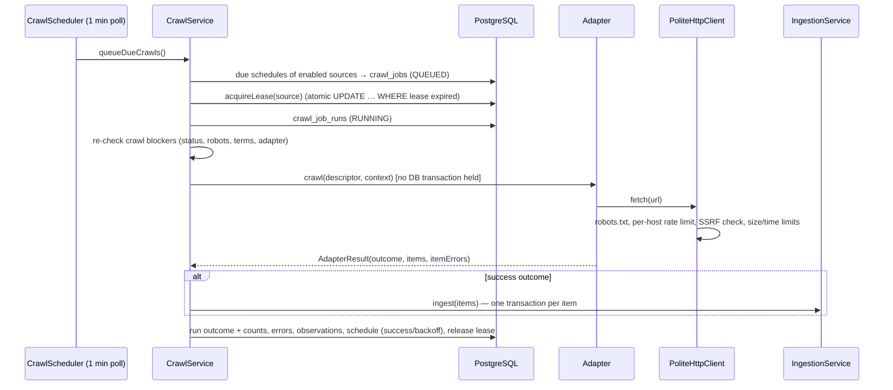

# Crawler design

## Flow

## Adapter contract

`ProcurementSourceAdapter { AdapterType type(); AdapterResult crawl(SourceDescriptor, CrawlContext); }`

Adapters must fetch only through `CrawlContext.fetch` (which records evidence), return a **failure outcome**
whenever the content cannot be read or lacks the expected structure, and populate only values present in
the source. They never persist anything.

| Adapter | Status | Configuration |
|---|---|---|
| `ETENDERS_PORTAL` | Implemented, live (enabled eTenders source) | `pageSize`, `maxPages`, `ocidPrefix` |
| `ETENDERS_OCDS` | Implemented, live-verified (alternative) | `pageSize`, `lookbackDays`, `maxPages`, `interpretTimesAsLocal` (default true), `timeZone` |
| `HTML_LISTING` | Implemented, live-verified (Tharisa, Exxaro dry runs) | `listContainerSelector` (required), `itemSelector`, `fields{name:{selector?,attr?,regex?}}`, `dateFormats`, `defaultEventType`, `eventTypeKeywords`, `statusMapping`, `nextPageSelector`, `maxPages`, `listUrl` |
| `JSON_API` | Implemented (fixture-tested) | `itemsPointer`, `fields{name: jsonPointer}`, `dateFormats`, … |
| `RSS_FEED` | Implemented (DTDs disabled) | `eventTypeKeywords`, `defaultEventType` |
| `CSV_LISTING` | Implemented | `columns{name: header}`, `delimiter`, `dateFormats` |
| `BROWSER_RENDERED` | **Not implemented** | Would need Playwright and explicit permission per source |
| `AUTHORISED_PLATFORM` | **Not implemented** | Requires authorised accounts/licensed APIs (SAP Ariba, Coupa, B1SA) |

Field names understood by the generic mapper: `referenceNumber, title, description, detailUrl, documentUrl,
status, location, province, category, closingDate, publishedDate, briefing, contactName, contactEmail, contactPhone`.

## Outcomes — a failure is never "zero opportunities"

| Outcome | Meaning | Retry |
|---|---|---|
| `SUCCESS` | Read; something new or changed | normal interval |
| `SUCCESS_ZERO_RESULTS` | Read; the listing structure was present and empty | normal |
| `NO_CHANGE` | Read; everything unchanged | normal |
| `SOURCE_UNAVAILABLE` | Connection failure, timeout, 404/410, 5xx | exponential backoff 30 min → 2 days |
| `RATE_LIMITED` | 429 | backoff |
| `CRAWL_FAILED` | Other errors | backoff |
| `AUTHENTICATION_REQUIRED` | 401/407 | daily; needs an authorised integration |
| `ACCESS_DENIED` | 403 (often bot protection) | daily; do not bypass |
| `PARSER_FAILED` | Expected structure missing, or every item rejected | daily; fix configuration |
| `BLOCKED_BY_ROBOTS` | robots.txt disallows | daily |
| `NOT_PERMITTED` | Status/terms/robots/adapter do not permit crawling | daily |

A failed run does not touch stored opportunities. A real-world example: on 2026-11-11 the Implats tender page
returned HTTP 200 with a PHP database error; the HTML adapter's `listContainerSelector` check turns that into
`PARSER_FAILED` instead of an empty listing.

## Politeness and safety

- Truthful `User-Agent` (configure a contact URL); no browser impersonation, CAPTCHA solving, identity rotation or evasion.
- robots.txt fetched and cached for 12 h per origin; 4xx = no restrictions (RFC 9309); `/robots.txt` served as HTML (soft 404) = no restrictions; unreachable = crawl fails as unavailable.
- Per-host rate limit from `source_registry.rate_limit_per_minute`.
- Request timeout (30 s), max response 15 MB, max 5 redirects.
- SSRF guard: loopback, private, link-local, multicast and unique-local addresses are refused, re-checked on every redirect (disabled only in tests).
- At most `OIP_CRAWLER_MAX_CONCURRENT` crawls per instance; a DB lease prevents two instances crawling one source.

## Ingestion, de-duplication and change detection

- Identity `(source_id, source_reference)`; a reference listed twice in one run is processed once.
- A SHA-256 hash over tracked fields short-circuits unchanged records.
- Field-level diffs are written to `source_change_events` with old/new values. Material fields: title,
  reference, closing date/time, status, briefing, documents. Non-material but recorded: description, category,
  location, value, contacts, source URL.
- Documents: new links recorded as material changes ("Added: …"); disappeared links get `removed_at`.
- An inferred OPEN status becomes EXPIRED once the closing moment passes (same rule in ingestion and the
  15-minute lifecycle job, so the two never disagree and cause change-event churn).

## eTenders portal feed (enabled)

- Covers every published tender (not a date window) and adds what OCDS lacks: `eSubmission`, the physical
  `delivery` address, `province`, compulsory briefing date/venue/flag, contact person/e-mail/phone, special conditions.
- **Submission method**: `eSubmission=true` → ELECTRONIC (provenance SOURCE); else special conditions explicitly
  requiring electronic/e-mail submission → ELECTRONIC (provenance DOCUMENT, condition quoted); else a delivery
  address → PHYSICAL with the address (SOURCE); else NOT_SPECIFIED. Live: 182 electronic, 1,900 physical, 18 not stated.
- Times are published without a zone (`2027-01-29T10:30:00`) — South African local time. **This settles the OCDS
  question below**: the OCDS API's `Z` times are SAST wall-clock times.
- Identifiers use `ocds-9t57fa-{id}`, so records continue those read from the OCDS API.
- Mining relevance: public tenders whose subject is mining (deterministic rules with evidence, e.g. "Mine Health and
  Safety Council", "mine residue disposal") are flagged `mining_related` and appear in the mining view.

## Document pipeline

A background job (every minute, 10 documents per run, soonest-closing open opportunities first, enabled sources
whose terms are not prohibited) downloads documents through the same polite client, stores the original
(`OIP_STORAGE_DIR`), detects the type from the bytes (PDF, Word, Excel, CSV, text only), extracts text with Apache
Tika (no macros, no embedded recursion) and applies deterministic rules: CIDB grade, B-BBEE level, preference system,
CSD, tax compliance, professional registration, ISO certifications, compulsory briefing, local content, submission
method and — when the listing has none — the closing date. Findings carry provenance `DOCUMENT` and the sentence
they came from; values a source published as fields are never overwritten, and a re-crawl does not erase
document-derived values. Failures retry after 6 h (3 attempts). Originals of opportunities closed for 90 days are
deleted; extracted text is kept and searchable.

## eTenders OCDS specifics (observed 2026-11-11)

- `tender.title` is the bid number; `tender.description` is the readable title.
- `tenderPeriod.endDate` carries a `Z` suffix, but times cluster on 10:00/11:00/12:00/16:00, which are South
  African business hours. The adapter interprets the wall-clock time as `Africa/Johannesburg` and keeps the raw
  value. **Confirm against published tender documents**; set `"interpretTimesAsLocal": false` if wrong.
- `value.amount = 0` means not published. `tender.status` is empty → status inferred. No province field.
- No per-tender web page: `source_url` is the official tender document (stable); `evidence_url` is the exact
  API query (it varies with paging and is not change-tracked).
- Live result: 427 releases in a 3-day window, 0 rejected; repeat crawl → `NO_CHANGE`.

## Adding a source

1. Verify the URL exists and what it contains (Test source), check robots.txt and terms of use.
2. Create/edit the source: status, robots, terms, adapter, parser configuration.
3. Use **Test source** until the preview is right; then **Crawl now**; then enable for scheduling.
