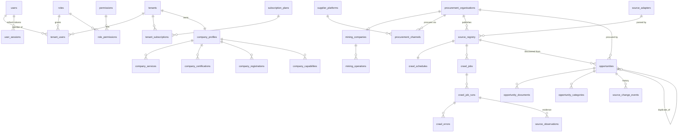

# Database design

PostgreSQL 17, migrations with Flyway (`backend/src/main/resources/db/migration`). Hibernate runs with
`ddl-auto=validate`, so the schema is defined only by migrations.

| Migration | Contents |
|---|---|
| V1 | roles, permissions, role_permissions, users, tenants, tenant_users, user_sessions, subscription_plans, tenant_subscriptions, audit_events, system_settings + reference roles/permissions |
| V2 | company_profiles and child tables (categories, services, products, commodities, regions, certifications, registrations, capabilities, references, documents) |
| V3 | reference_codes, procurement_organisations, mining_companies, mining_operations, supplier_platforms, procurement_channels, procurement_contacts, source_adapters, source_registry, crawl_schedules |
| V4 | Seed: event types, statuses, categories, industries, adapters, organisations, supplier platforms, channels, sources, schedules |
| V5 | crawl_jobs, crawl_job_runs, crawl_errors, source_observations, opportunities, opportunity_documents, opportunity_categories, source_change_events |
| V6 | Marks implemented adapters |
| V7 | Submission method/channel/address with provenance and evidence, briefing date/venue, special conditions, mining relevance; ETENDERS_PORTAL adapter; source terms-review outcomes |
| V8 | source_documents (stored originals + extracted text with GIN search), opportunity_requirements (with provenance/evidence), closing_provenance, company document text |
| V9 | AI settings, ai_processing_audit, ai_processing_jobs, ai_classification_results, assistant conversations/messages, tenant_match_settings, opportunity_matches |
| V10 | tenant_opportunities, bid_pipeline_history, opportunity_notes, opportunity_tasks, bid_decisions, bid_team_members, bid_documents, notification_preferences, notifications (unique per user + dedup key), notification_deliveries, users.deleted_at |
| V11 | rate_limit_counters, retention settings |
| V12 | State-land leasing source (DLRRD) and focus_areas |
| V13 | DLRRD listing parser configuration |
| V14 | account_tokens (password reset, invitations, e-mail verification; hashed, single use), users.email_verified_at |
| V15 | Bootstrapped platform administrators treated as verified |
| V16 | opportunities.title_vector (ranked focus search), focus_areas.search_documents and exclude_keywords |
| V17 | Tender-form details on company_profiles (CSD, income tax, UIF, Compensation Fund, CIDB CRS, addresses, B-BBEE certificate); company_directors (identity numbers AES-GCM encrypted by the application, last 4 digits in clear); form_fills (draft placements as JSONB, linked to the generated bid document) |

Conventions: UUID primary keys; `created_at`/`updated_at` (UTC `timestamptz`), `created_by`/`updated_by` and a
`version` column for optimistic locking on mutable aggregates; enumerations stored as text with `CHECK`
constraints that mirror the Java enums; every tenant-owned row carries `tenant_id`.

## ERD (implemented tables)

## Important rules

- **Opportunity identity.** Unique on `(source_id, source_reference)`. `source_reference` is the most stable
  identifier the source offers (OCDS `ocid`, listing reference, detail URL, document URL). Reference numbers
  are **not** assumed globally unique.
- **Cross-source duplicates** are linked (`duplicate_of_id`) only when the same organisation publishes the same
  normalised reference number (≥ 5 characters) from another source. Both records are kept; the catalogue hides
  linked duplicates by default.
- **Closing dates.** `closing_date` (SA local date), `closing_at` (exact instant, only when the source gives a
  time), `closing_time_specified`, and `closing_raw` (verbatim). Expiry uses `closing_at` when known, otherwise
  the end of `closing_date` in South African time.
- **Status provenance.** `status_inferred = true` when status was derived (e.g. from the closing date) rather
  than published.
- **Search.** `opportunities.search_vector` is a generated `tsvector` (reference/title weight A, category B,
  locality/description C) with a GIN index.
- **Sources may only be enabled** when the `ck_source_enabled_requires_permitted_access` constraint holds.

## Notes on spec tables

- `match_scores` / `match_explanations` are columns of `opportunity_matches` (dimension scores, matched, missing,
  disqualifiers, AI explanation as JSONB) because they are always read together.
- `bid_pipeline` is `tenant_opportunities` (stage, priority, assignee) + `bid_pipeline_history`;
  `opportunity_assignments` is the `assigned_to` column with history events.
- Not created (no code needs them yet): `opportunity_locations`, `opportunity_tags`, `opportunity_company_links`.
- Every tenant-specific table carries `tenant_id` and references the global `opportunities.id`; nothing tenant-specific
  is written to `opportunities`.
